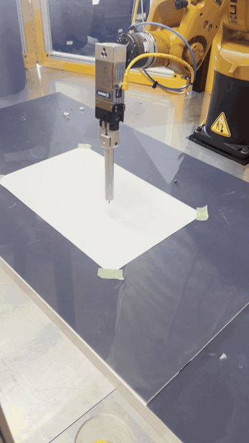
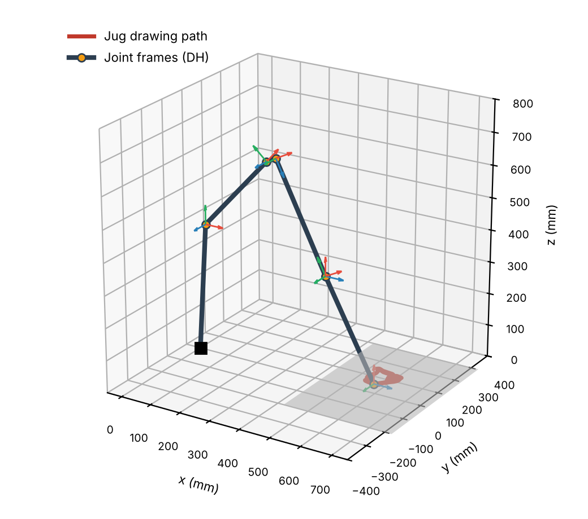
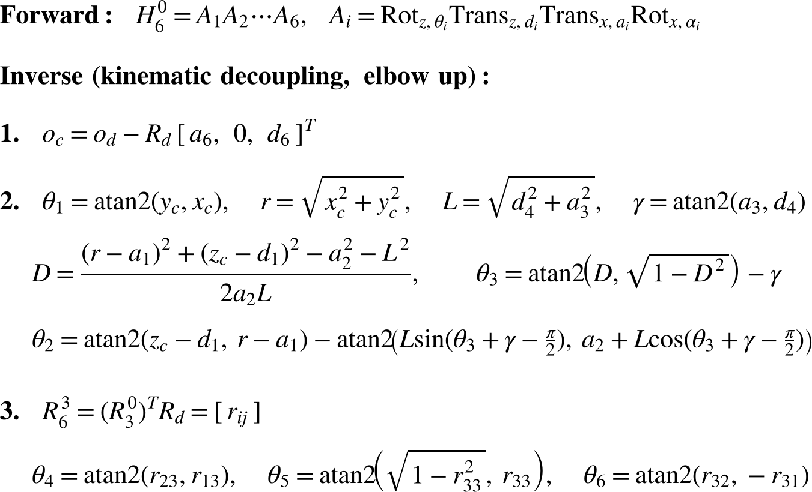
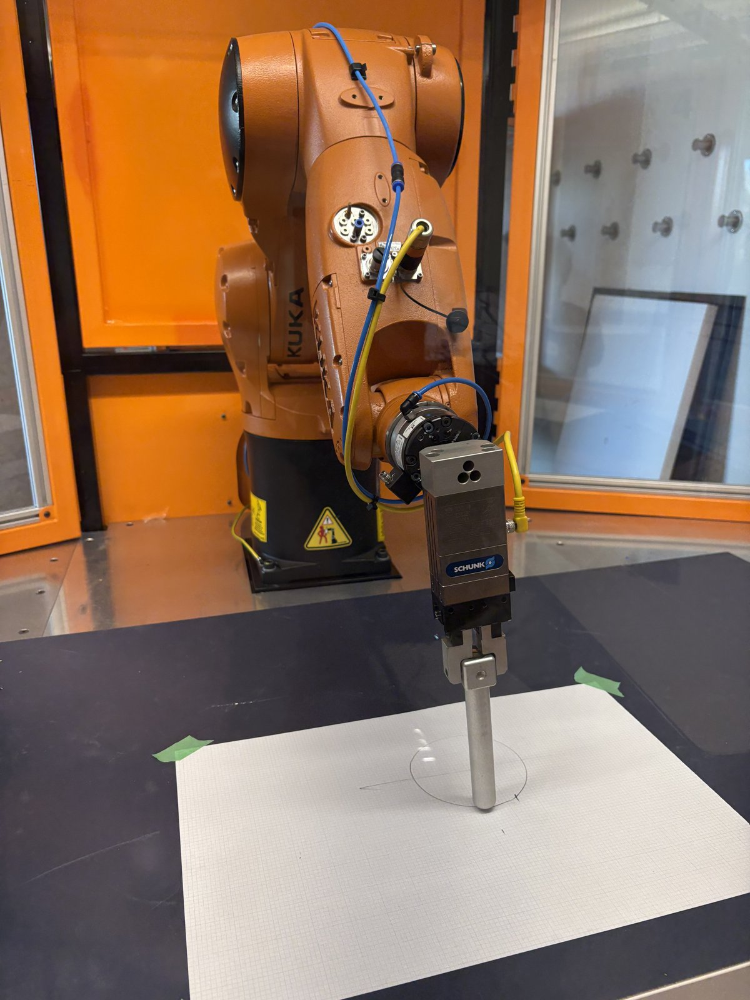
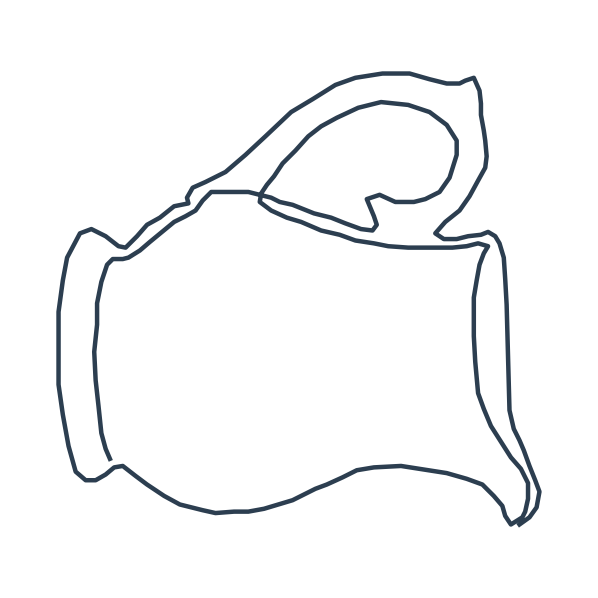
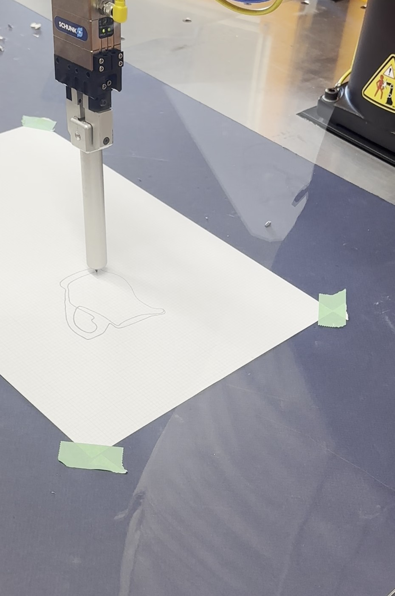

# KUKA Robotic Arm: Kinematics-Driven Drawing

Forward and inverse kinematics for a 6-DOF KUKA industrial arm, derived from scratch and used to make the arm draw custom designs on paper with a pencil.

**Solomon Pius** · University of Toronto · Fall 2026

<p align="center"><br><em>The KUKA drawing the jug design (8x speed)</em></p>

---

## How it works

```
Design (x, y) points  →  3-point paper calibration  →  paper frame → base frame  →  inverse kinematics  →  joint commands to KUKA
```

1. **Model the arm.** Assign Denavit-Hartenberg frames to all six links and write out the DH table.
2. **Solve the inverse kinematics.** Kinematic decoupling splits the problem in two: find the wrist centre and solve the first three joints (elbow-up solution), then solve the spherical wrist from R₆³ = (R₃⁰)ᵀR_d.
3. **Calibrate.** Jog the pencil to three points on the paper and record the joint angles. Then solve for the tool offset corrections that minimize forward kinematics error, and fit the paper plane.
4. **Draw.** Convert each design point from the paper frame to the robot base frame, solve the inverse kinematics with the pencil pointing straight down, and stream the joint angles to the robot.

## Kinematic model

| Link | a (mm) | α | d (mm) | θ |
|---|---|---|---|---|
| 1 | 25 | π/2 | 400 | θ₁ |
| 2 | 315 | 0 | 0 | θ₂ |
| 3 | 35 | π/2 | 0 | θ₃ |
| 4 | 0 | −π/2 | 365 | θ₄ |
| 5 | 0 | π/2 | 0 | θ₅ |
| 6 | −296.23 | 0 | 161.44 | θ₆ |

<p align="center"></p>

### Derivation

<p align="center"></p>

## Calibration

The pencil tip's real position differs slightly from the nominal tool offsets a₆ and d₆. Three calibration points were measured on the paper, and `fminunc` solved for the corrections that minimize the summed forward kinematics error:

| Parameter | Nominal | Correction | Calibrated |
|---|---|---|---|
| a₆ | 296.23 mm | +1.30 mm | 297.53 mm |
| d₆ | 161.44 mm | +1.68 mm | 163.12 mm |

The same three points define the paper plane, which gives the transform from the paper frame to the robot base frame (`FrameTransformation.m`).

## Results

The arm drew a straight line, a circle and a 187-point jug outline.

| | | |
|:-:|:-:|:-:|
|  |  |  |
| KUKA drawing the circle | Jug design (input path) | Jug drawn by the KUKA |

## Python port

[`python/kuka_kinematics.py`](python/kuka_kinematics.py) re-implements the forward kinematics, inverse kinematics and paper transform in NumPy, so the math can be checked without MATLAB. It solves all 187 points of the jug design and confirms each solution with forward kinematics:

```bash
pip install -r python/requirements.txt
python python/kuka_kinematics.py
# Jug design: 187 points
# Max FK(IK) position error: 2.56e-13 mm
```

## Repository structure

```
├── matlab/
│   ├── kuka/
│   │   ├── forward_kuka.m          # Forward kinematics (DH chain)
│   │   ├── inverse_kuka.m          # Elbow-up inverse kinematics
│   │   ├── mykuka.m                # Robotics Toolbox model from a DH table
│   │   ├── mykuka_search.m         # Model with perturbed tool offsets (calibration)
│   │   ├── deltajoint.m            # Calibration cost function
│   │   ├── FrameTransformation.m   # Paper frame → base frame
│   │   ├── calibrate_kuka.m        # Calibration and setup tests
│   │   ├── draw_line.m             # Straight line
│   │   ├── draw_circle.m           # 100 mm circle
│   │   ├── draw_design.m           # Custom design from a spreadsheet
│   │   └── designs/jug.xlsx
│   └── puma560/                    # PUMA 560 kinematics in simulation (see below)
├── python/
│   ├── kuka_kinematics.py          # NumPy port + verification + 3D plot
│   └── requirements.txt
└── docs/images/
```

## Running the MATLAB code

Requirements:

- [Robotics Toolbox for MATLAB](https://petercorke.com/toolboxes/robotics-toolbox/) (Peter Corke) for `Link`, `SerialLink` and `eul2tr`
- Optimization Toolbox for `fminunc`
- Simulink 3D Animation for `vrrotvec` and `vrrotvec2mat`

On the robot:

1. Run `calibrate_kuka.m` section by section. It connects to the robot, records the calibration points, solves for the tool offset corrections and builds `myrobot`.
2. With `myrobot` in the workspace, run `draw_line.m`, `draw_circle.m` or `draw_design.m`. Each script builds the target poses, solves the inverse kinematics, then streams the joint angles with `setAngles`.

> The robot interface functions (`startConnection`, `moveAxis`, `getAngles`, `setAngles`) come from the robot's control environment and are not included here.

## Foundation: PUMA 560 in simulation

Before the KUKA, the same approach was built and tested in simulation on a PUMA 560: a DH model, a closed-form forward and inverse kinematics solution, and trajectory tracking. See [`matlab/puma560/`](matlab/puma560/) and run `puma560_demo.m`.
